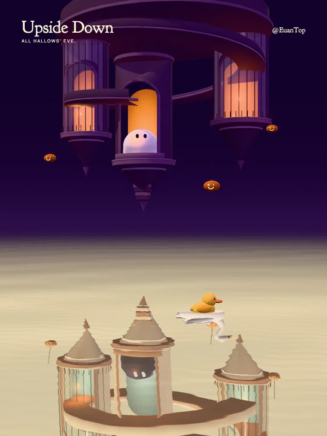

<h1 align="center">No Need to Arrive</h1>
<p align="center">No destination. No hurry.</p>
<p align="center"><strong>English</strong> · <a href="README.zh-CN.md">简体中文</a></p>

<p align="center">
  
</p>

An interactive artwork: a yellow duck circles an inhabited glass knot, held by an unhurried ghost. Reading, sewing and planting share one continuous path. Stars and a fading white trace mark its passage. By **@EuanTop**.

The current 28.8-second film and RGB/PCM master have been exported and verified locally.

### Run

Requires Node 22.12+.

```sh
npm ci
npm run dev
```

Open `http://127.0.0.1:5175/`. The collapsible panel controls framing, lens, palette, movement, starlight and light-trail strength. Defaults: **3:4, Deep violet, 40° elevation, 35° field of view**, movement 0.95, trail 1.35 and starlight 0.9. Music is enabled after the browser's first playback gesture.

### Design

- A parametric trefoil defines both the glass geometry in GLSL and the duck’s route.
- Widened, level pockets hold furniture; the central swimming lane stays clear.
- Arc-length playback drives the star canal’s white light trace. It spreads and fades over 3.8 seconds, remains attached to the pipe, and continues across the loop seam.
- The duck slows at each living pocket to nudge a cup, brush hanging cloth and open a drawer. Reactions follow contact and settle naturally.
- One large sheet ghost watches the duck from below. Curved sleeves and a rounded crown share one continuous surface; the whole upper head bends back at the neck. The habitat completes a full turn with a gentle counter-tilt. Duck, furniture and glass share that transform.
- Local fonts and procedural geometry; no external model files.
- The duck keeps the round head, short bill and oval wings of the series' previous little passenger. Warm key light, cool fill and glass highlights separate its forms.
- Transmissive glass, rounded studio reflections, warm edge light and an art-directed cylindrical-lens caustic approximation add depth without a full-screen blur. Pale lavender and deep violet backgrounds are selectable.
- Original 100 BPM score with a half-time foreground: two rounded bass gestures and one sustained chord per bar, sparse synthesized duck calls, counter-orbiting harmonic clouds and a closing shadow-organ passage. No drum kit. Cosmic bass follows the chord roots; travelling stereo reflections wrap with the 28.8-second scene.
- Decoded PCM loops continuously on the Web Audio clock. Preview follows that clock; routine control polling never seeks or restarts the score.

### Control and checks

The panel and automation share the local API; see [control API](docs/control.md). Media belongs in ignored `artifacts/`.

```sh
npm run build
npm test
npm run music
```

Tests cover the scene, sparse foreground rhythm, deterministic audio, stereo and loop continuity. `npm run music` writes the current WAV and score metadata to `artifacts/audio/`; preview checks its version automatically. Video exports use timestamped directories under `artifacts/exports/`; `latest` points to the newest verified version. Older completed exports are retained.

Code: [MIT](LICENSE). Goudy Bookletter 1911: [SIL OFL](public/fonts/OFL.txt).
