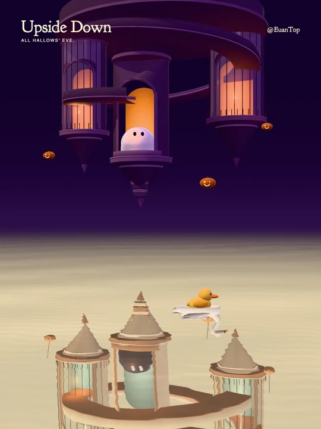

<h1 align="center">倒悬鬼屋 · Upside Down</h1>
<p align="center">All Hallows’ Eve.</p>
<p align="center"><a href="README.md">English</a> · <strong>简体中文</strong></p>
<p align="center"></p>

两个倒悬空间在水面相接，鸭子与天鹅穿过昼夜，门洞里的幽灵眨眼并轻轻转头注视。作者 **@EuanTop**。

当前为视觉开发版，尚未导出这一版的完整成片。

### 启动

需要 Node 22.12+。

```sh
npm ci
npm run dev
```

访问 `http://127.0.0.1:5175/`。右侧面板与 [本机控制接口](docs/control.md) 共用参数。默认 **3:4**，场景周期 **28.8 秒**；音乐首次播放需要浏览器交互。

### 实现

- 参数化悬挂塔楼、凹入拱门、曲廊与南瓜吊灯。
- 天空与湖面共用黑—紫—暖黄渐变，色域在建筑转动后稍晚跟随；柔和的水平水际线与稍冷的水面色泽区分天空和湖面。
- 两个世界保留各自的三维几何，以水面裁切区分上下视图，仅水下部分受波纹扰动；环廊与三个尖锥各自动作。
- 幽灵保持简洁形态，仅眨眼、轻微转头；鸭子与天鹅分别扇翅，沿连续的前抛弧线穿过水面。
- 沿用上一作的鸭子、布面构建方法与光照方法，重新搭建空间构图及配乐。
- 全新 50 BPM 氛围配乐：长和弦、居中低音、缓慢环绕的共同音，以及合成鸭声与天鹅声的双重奏；两者交换领奏与和声，速度不变；循环混响保留尾音。
- 尾迹保留湖面世界坐标，交换时不跟随主角切换；入水与出水涟漪停留在原接触点。
- 可切换彩色印刷、胶片、紫色版画三种后处理及 Original，强度可调，不使用全屏模糊。
- 字体本地化，几何由代码生成；天鹅 GLB 沿用本系列 Crescent Lake 中自行建立的模型。当前场景位于 `src/inverted/`，源码保留此前的实验模块。

```sh
npm run build
npm test
```

检查包括曲廊面朝向、水面净空、游动模型设置与循环连续性。媒体、浏览器缓存和生成产物放在 Git 忽略的 `artifacts/`。本机预览不会发布或上传文件。

源码：[MIT](LICENSE)。Goudy Bookletter 1911：[SIL OFL](public/fonts/OFL.txt)。
